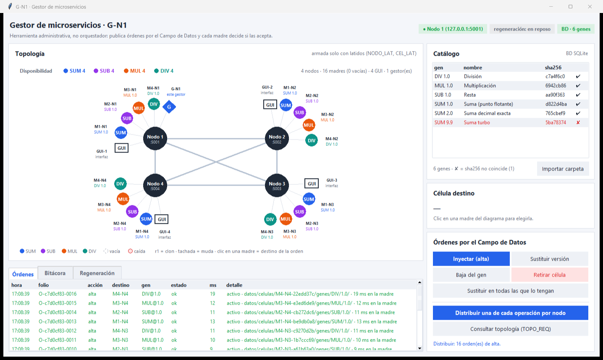
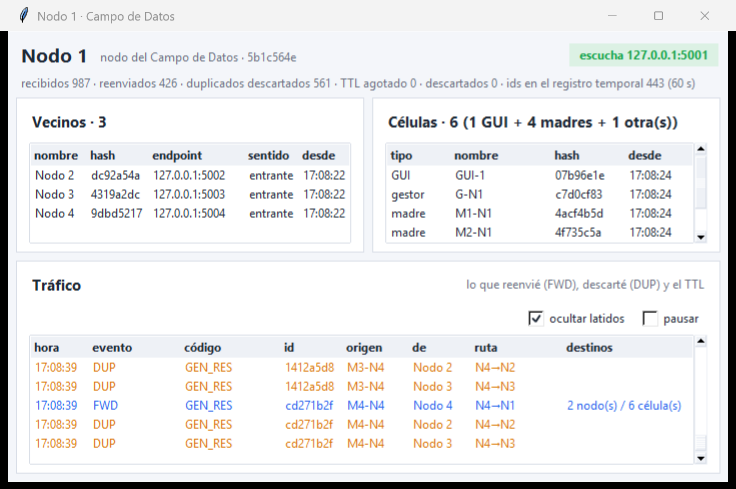
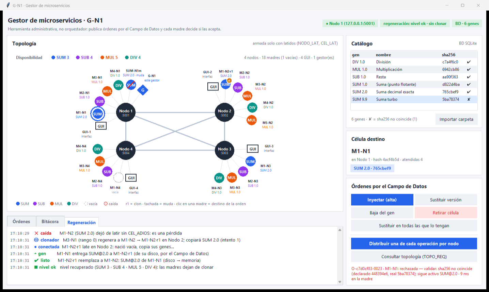
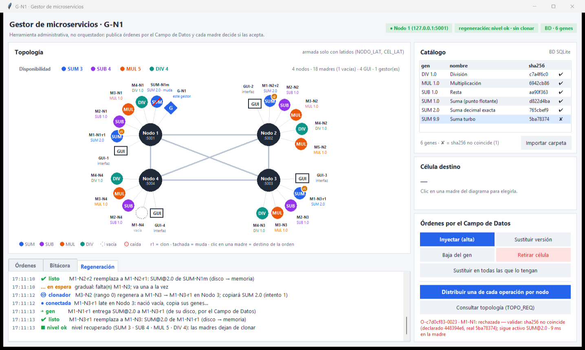
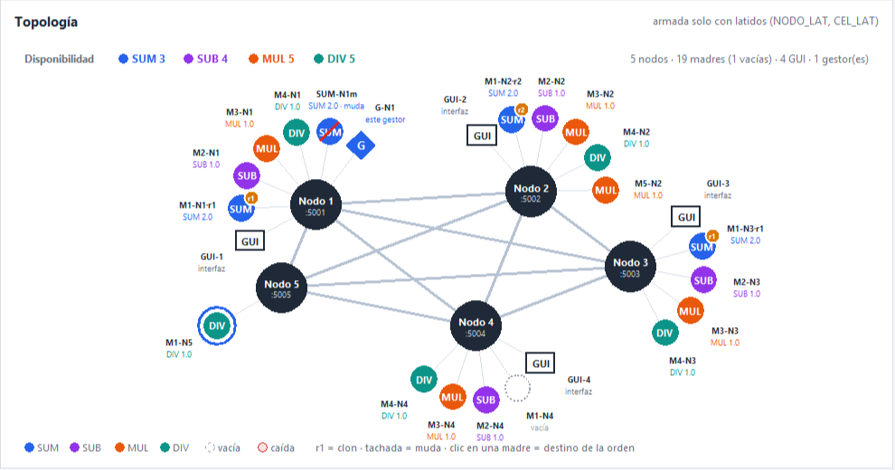

# Reporte Técnico de la Calculadora ADS

**Materia:** Cómputo Distribuido

**Proyecto:** Tercer Parcial. Evolución de la calculadora distribuida bajo arquitectura ADS:
foliado, carga dinámica de microservicios, autorrecuperación y gestor de servicios

**Fecha del enunciado:** 13 de noviembre de 2026

| | |
|---|---|
| **Alumno** | `<NOMBRE COMPLETO>` |
| **Matrícula** | `<MATRÍCULA>` |
| **Grupo** | `<GRUPO>` |
| **Lenguaje** | Python 3.14, solo librería estándar (entorno con uv) |
| **Código fuente** | `<LIGA AL REPOSITORIO>` |
| **Video de demostración** | `<LIGA AL VIDEO>` |

---

## Contenido

| Parte | Secciones |
|---|---|
| **I. Introducción** | 1. Introducción, objetivo y alcance · 2. Matriz de trazabilidad con el enunciado |
| **II. Diseño** | 3. Arquitectura final y topología · 4. Lo heredado del segundo parcial · 5. Protocolo de foliado · 6. Genes activos y carga dinámica · 7. Gestor de servicios y topología · 8. Protocolo de autorrecuperación · 9. Tolerancia a fallas · 10. Información de control distribuida |
| **III. Evidencia y conclusión** | 11. Pruebas automatizadas · 12. Escenarios ejecutados · 13. Bugs encontrados · 14. Decisiones y limitaciones · 15. Diferencias respecto a lo visto en clase · 16. Originalidad · 17. Conclusiones |
| **Anexos** | A. Glosario · B. Constantes · C. Cómo correrlo y documentación complementaria |
| **Referencias** | Fuentes consultadas (APA, 7.ª edición) |

# PARTE I. INTRODUCCIÓN

## 1. Introducción, objetivo y alcance

### 1.1 Del segundo al tercer parcial

El segundo parcial dejó una calculadora sobre una **arquitectura de sistemas autónomos
descentralizados (ADS)** (Mori, 1993): cuatro nodos que forman solos una malla completa, un
**Campo de Datos** por el que todo viaja por broadcast, y células que toman de ahí solo lo que su
**Código de Contenido** les indica. Ninguna pieza era indispensable. Pero cada célula servidor
traía la suma o la división **compilada en su programa**, y si una moría, nadie la reponía.

El tercer parcial pide que esa funcionalidad viva en **genes** que se cargan, cambian y copian
mientras el sistema corre, y que el sistema **se cure solo**. La idea, en una frase: las células
servidor ahora son **células madre vacías** que pueden hacer cualquier operación porque **jalan
programas** de disco; un **gestor de microservicios** con base de datos dibuja la topología e
inyecta esos programas **por el Campo de Datos**; cada operación lleva **folio y huella**; y si
una célula muere, las demás la **regeneran solas**, una a la vez, **sin orquestador** y **sin
"cáncer"**, y la nueva **copia los genes** que hacían falta. Son problemas clásicos de los sistemas
distribuidos (replicación, detección de fallas, acuerdo sin coordinador; Coulouris et al., 2011;
Tanenbaum y Van Steen, 2023), resueltos aquí sin romper la regla de ADS de que nadie manda.

### 1.2 Objetivo general y objetivos específicos

**Objetivo general.** Evolucionar el sistema ADS del segundo parcial incorporando foliado, carga
dinámica de microservicios, autorrecuperación y administración distribuida de servicios, sin
dependencia de una unidad central (objetivo general del enunciado).

1. Que cada solicitud lleve un **folio** y una **huella** con los que la GUI reconozca lo suyo y
   cada célula decida qué atender, con **ACK**, **mínimo de ACK** y un **evento** con fases
   identificables.
2. Que el programa base de la célula servidor **no sepa sumar**: la funcionalidad vive en genes
   que se **localizan, validan, cargan, activan y descargan** en ejecución.
3. Un **gestor** que consulte la topología y dé de **alta, baja o sustituya** genes en la célula
   que el administrador elija, sin que el sistema dependa de él.
4. Que la pérdida de una célula se **detecte y se repare sola**, de forma **gradual**, con un
   alto claro al recuperar el nivel y límites que impidan el crecimiento ilimitado.
5. Verificarlo con **pruebas automatizadas** y con los **ocho escenarios** del enunciado en vivo.

### 1.3 Alcance

| Programa | Paquete | Qué es |
|---|---|---|
| Nodo del Campo de Datos | `nodo/` | Heredado. Acepta la nueva entidad `GESTOR` y emite su latido `NODO_LAT` |
| Célula cliente (GUI) | `interfaz/` | Heredada, con foliado, eventos, ráfaga y "ajenas ignoradas" |
| Célula servidor = **célula madre** | `madre/` | **Nueva.** Programa base genérico sin aritmética; sustituye al `servidor/` del segundo parcial |
| Microservicios (genes) | `microservicios/` | **Nuevo.** Programas en disco: `SUM 1.0`, `SUM 2.0`, `SUB 1.0`, `MUL 1.0`, `DIV 1.0` y `SUM 9.9` (manipulado a propósito) |
| Gestor de microservicios | `gestor/` | **Nuevo.** Ventana con base de datos SQLite, diagrama vivo de la topología y órdenes |
| Panel y sonda | `panel/`, `sonda/` | Herramientas de demostración **fuera del sistema** |

Todo está escrito en **Python 3.14 con la librería estándar** (sockets, hilos, Tkinter,
`importlib`, `sqlite3`, `hashlib`; Python Software Foundation, 2025a, 2025b, 2025c) y el entorno
se maneja con **uv**. Se renunció a propósito a
los puntos extra de Java (§1 del enunciado).

### 1.4 Sobre las bitácoras

Todas las bitácoras citadas son **reales**. Salen de la verificación en vivo del 17 de noviembre
de 2026 con el código final (procesos reales: 4 nodos que luego fueron 5, 16 madres vacías, 4
GUIs y un gestor), y las figuras son capturas de esa misma corrida. Los hashes se muestran con sus
primeros 8 caracteres y las líneas largas se recortan con `…`.

---

## 2. Matriz de trazabilidad con el enunciado

Cada requisito del PDF con su identificador (el mismo de `docs/REQUISITOS.md`), dónde está
implementado, la sección que lo explica y la escena del video (`GUION_VIDEO.md`) que lo demuestra.

| ID | Requisito | Implementación (archivo → función) | Sección | Escena |
|---|---|---|---|---|
| L1 | Cualquier lenguaje | Python 3.14, librería estándar; uv | §1.3 | N/A |
| L2 | Java da puntos extra | Se renuncia a propósito | §1.3 | N/A |
| E1 | Reporte técnico | Este documento | Todo | N/A |
| E2 | Video con audio | `GUION_VIDEO.md` | §12 | N/A |
| E3 | Código: clientes, servidores, nodos, microservicios y gestor | `interfaz/`, `madre/`, `nodo/`, `microservicios/`, `gestor/` | §3.1 | N/A |
| O1 | Originalidad | Reutilización propia declarada | §16 | N/A |
| B1 | Suma, resta, multiplicación y división | Genes `microservicios/{SUM,SUB,MUL,DIV}/1.0/`; `madre/genes.py` → `ejecutar()` | §6 | 4 |
| B2 | Tres programas base | `interfaz/`, `madre/`, `nodo/` | §3.1 | 2 |
| B3 | 4 nodos en malla completa | `nodo/nucleo.py` → `Nodo._supervisar()`, `_marcar()`, `_difundir_pares()` | §4.1 | 2 |
| B4 | Cuatro GUIs | `interfaz/`; `panel/procesos.py` → `Procesos.configuracion()` | §3.2 | 2 |
| B5 | Cuatro células por operación | `gestor/nucleo.py` → `Gestor.distribuir()`, o modo "con servicios" (`--genes`) | §3.2, §7.3 | 2 |
| B6 | Por nodo: una GUI y una célula de cada operación | Ídem | §3.2 | 2 |
| B7 | Conexión entre nodos | `HOLA` / `BIENVENIDA` / `PARES` / `RECHAZO`; `Nodo._registrar_vecino()` | §4.1 | 2 |
| B8 | Conexión entre células y nodos | `celula/base.py` → `Celula._intentar()`; `Nodo._registrar_entrante()` | §4.1 | 2 |
| B9 | Comunicación por Código de Contenido | `comun/codigos.py`; `Celula.publicar()` | §4.4 | 3 |
| B10 | Broadcast sin ciclado | `Nodo._difundir()`; `comun/vistos.py`; TTL; horizonte dividido | §4.2 | 3 |
| B11 | Sin límite de nodos ni de células | Gossip con una semilla cualquiera; panel "+ Nodo", "+ Madre" | §4.1, §12 | 10 |
| B12 | Sin unidad central ni nodo maestro | Todo el diseño | §3.3, §10 | 11 |
| F1 | Folio que correlaciona eventos, ACK y respuestas | `comun/foliado.py` → `folio()`; `interfaz/nucleo.py` → `Interfaz.solicitar()` | §5.1 | 3 |
| F2 | La GUI reconoce sus respuestas | `Interfaz.procesar()`, `_huella_ajena()`; contador "ajenas ignoradas" | §5.3 | 3 |
| F3 | Folio + Código de Contenido para atender o ignorar | `madre/nucleo.py` → `Madre.procesar()`; `madre/rondas.py` → `rx_req()`, `rx_fin()` | §5.3 | 3 |
| F4 | Huella (origen y trayectoria lógica) | `foliado.huella()`, `sello()`, `con_paso()`, `validar()` | §5.1 | 3 |
| F5 | ACK de recepción y participación | `Rondas.rx_req()` publica `X_ACK` antes de encolar | §5.1, §5.4 | 3 |
| F6 | Mínimo de ACK | `Interfaz.ajustar_minimo()`, `_confirmar()` | §5.1 | 5 |
| F7 | Tolerancia si no responden todas | `Interfaz._cerrar_ventana()` (ausentes); `_vencer()` (reintentos) | §5.1, §9 | 5 |
| F8 | Evento: inicio, confirmación, procesamiento y finalización | `Interfaz._publicar_req()`, `_confirmar()`, `_aceptar()`, `_finalizar()` (`X_FIN`) | §5.1, §5.4 | 3 |
| M1 | Microservicios en disco | `microservicios/`; `madre/almacen.py` → `Almacen.guardar()` | §6.1, §6.3 | 6 |
| M2 | Carga en memoria durante la ejecución | `madre/genes.py` → `cargar()` (`importlib`) | §6.4 | 6 |
| M3 | Programa base sin la lógica de las operaciones | `madre/` no contiene aritmética; `genes.ejecutar()` | §6.2 | 6 |
| M4 | Los genes cambian en operación mediante el gestor | `Gestor.inyectar()`, `sustituir()`, `baja()`; `madre/ordenes.py` | §7.3 | 7 |
| M5 | Explicar localizar, validar, cargar, activar y descargar | Este reporte | §6.4 | N/A |
| A1 | Detectar la baja de disponibilidad | `madre/regeneracion.py` → `Regeneracion._detectar()` | §8.3 | 8 |
| A2 | Las células deciden cuándo generar otra instancia | `Regeneracion._turno()`, `_aptas()`; `comun/hashes.py` → `ranking()` | §8.3, §8.4 | 8 |
| A3 | La nueva célula recupera sus genes | `madre/copia.py` → `Copia._copiar()`; `Madre.pedir_gen()` | §8.3, §7.5 | 8 |
| A4 | Sin controlador central | Cada madre corre `Regeneracion.revisar()` | §8.1 | 8 |
| A5 | Detener la clonación al nivel requerido | `Regeneracion._quizas_nivel_ok()` → `NIVEL_OK` | §8.4 | 9 |
| A6 | Impedir la generación ilimitada (cáncer) | `Regeneracion._topes()`, `_aptas()`, `_cupo()` | §8.5 | 9 |
| A7 | Una falla local no pierde el servicio | Rango r con `RELEVO_CLON`; copia desde cualquier madre, gestor o banco | §8.4, §9 | 8 |
| G1 | Arrancar sin microservicios | `python -m madre` sin `--genes`; panel "Configuración mínima — vacía" | §3.2, §6.3 | 2 |
| G2 | Alta de un servicio | `Gestor.inyectar()` → `GEN_INYECTA` | §7.3 | 6 |
| G3 | Baja de un servicio | `Gestor.baja()` → `GEN_BAJA`; `Madre.dar_de_baja()` | §7.3 | 7 |
| G4 | Modificar o sustituir un servicio | `Gestor.sustituir()`, `sustituir_en_todas()`; `Madre._instalar()` | §6.5, §7.3 | 7 |
| G5 | Usar la topología para decidir | `gestor/topologia.py`; clic en el diagrama = destino; `distribuir()` | §7.4 | 6 |
| G6 | Topología con nodos, células y servicios activos | `NODO_LAT`, `CEL_LAT` → `Topologia.nodo_lat()`, `celula_lat()` | §7.4 | 2 |
| G7 | No depender del gestor | Órdenes por broadcast; la regeneración es de las madres | §7.1, §12 | 11 |
| G8 | Alta, baja y cambio se reflejan en la carga dinámica | `GEN_ESCRITO` → `GEN_VALIDADO` → `GEN_CARGADO` → `GEN_ACTIVO` en la madre | §6.6 | 7 |
| P1 | Sin unidad central indispensable | Gestor y panel fuera del camino de las operaciones | §3.3 | 11 |
| P2 | Sin nodo maestro | Gossip y failover (`Celula._rotacion()`); `test_nodo_tumbado_failover_y_el_servicio_sigue` | §4.5 | N/A |
| P3 | Nodos y células flexibles | Nodo 5 y madres nuevas en vivo | §4.1, §12 | 10 |
| P4 | Protocolos con altas, bajas, fallas y nuevas instancias | Escenarios 4 a 8 | §12 | 6–10 |
| P5 | La pérdida de una célula no es punto único de falla | Cualquier madre regenera a cualquiera | §8.4, §9 | 8 |
| P6 | Recuperación gradual y controlada | Turno único + `PAUSA_REGENERACION` + topes | §8.5 | 9 |
| P7 | Control de foliado, ACK, topología y recuperación distribuido | Ver tabla | §10 | N/A |
| C1 | Esquema de la Figura 1 del enunciado | Diagrama del gestor (Figura 1 de este reporte) | §3.2 | 2 |

### 2.1 Escenarios y evidencias mínimas

| Escenario del enunciado (§10) | Evidencias mínimas (§9) | Dónde se ve | Sección |
|---|---|---|---|
| — Arranque (base heredada) | V1 nodos · V2 células conectadas · V3 conexión y broadcast | Diagrama del gestor, ventana del nodo (`FWD`/`DUP`) | §3.2, §4 |
| S1 Operación normal con foliado | V4 código y folio · V5 huella, ACK, mínimo y evento · V6 cada GUI lo suyo | Tarjeta del evento de GUI-1; GUI-2 sin mostrarlo | §5.4, §5.5 |
| S2 Solicitudes simultáneas | V6 | Ráfaga ×8 en GUI-1 y GUI-2 a la vez | §12 |
| S3 Mínimo de ACK y tolerancia | V5 | `AUSENTES: SUM-N1m`, ACK 4/2 de 5 | §5.5, §12 |
| S4 Carga dinámica | V7 disco → memoria · V8 alta · V9 topología | Madre vacía → `MUL 1.0` desde el gestor | §6.6, §7 |
| S5 Baja y modificación | V8 baja y cambio | `0.1 + 0.2`: `0.30000000000000004` → `0.3`; `SUM 9.9` rechazado | §6.5, §12 |
| S6 Falla y autorrecuperación | V10 detección · V11 clonación | Rojo → naciendo → `M1-N2·r1` con su gen copiado | §8.6 |
| S7 Prevención del cáncer | V12 alto de la clonación | `NIVEL_OK`; tres pérdidas, una por una | §8.7 |
| S8 Cambio de topología | V9 | Nodo 5 y una madre nueva en él, con gen inyectado | §12 |
| — Sin unidad central | V13 | Gestor cerrado: se opera y se regenera | §12 |

### 2.2 Contenido mínimo del reporte (§11 del enunciado)

| ID | Tema | Sección | ID | Tema | Sección |
|---|---|---|---|---|---|
| D1 | Arquitectura final | §3 | D8 | Tolerancia a fallas | §9 |
| D2 | Topología de la demostración | §3.2 | D9 | Genes activos y carga dinámica | §6 |
| D3 | Protocolo de conexión heredado | §4.1 | D10 | Gestor y representación de la topología | §7 |
| D4 | Comunicación y prevención de ciclos | §4.2 | D11 | Protocolo de autorrecuperación | §8 |
| D5 | Formato de mensajes y Códigos de Contenido | §4.3, §4.4 | D12 | Cuándo clonar y cuándo detenerse | §8.4 |
| D6 | Diseño del foliado | §5 | D13 | Evidencias de pruebas y escenarios | §11, §12 |
| D7 | Huella, ACK, mínimo de ACK y evento | §5.1 | D14 | Limitaciones y decisiones | §14 |

# PARTE II. DISEÑO

## 3. Arquitectura final y topología

### 3.1 Componentes

La arquitectura es la del segundo parcial con dos piezas nuevas: las células servidor son ahora
**madres** que cargan genes desde `microservicios/` (banco local) o desde la red a su propio
almacén en disco (`datos/celulas/*/genes/`), y el **gestor** es una célula más, conectada a
cualquier nodo. La Figura 1 (§3.2) la muestra tal como la dibuja el gestor.

| Componente | Papel en ADS | Qué hace |
|---|---|---|
| Nodo (`nodo/`) | Campo de Datos | Forma la malla por gossip e inunda con supresión de duplicados y TTL. **No lee el `cuerpo`** de ningún mensaje |
| Célula base (`celula/base.py`) | ACP: lo común | Se conecta, se presenta, hace failover, deduplica, publica, **late** (`CEL_LAT`) y contesta `TOPO_REQ` |
| GUI (`interfaz/`) | ASM de la calculadora | Folia, cuenta ACK, muestra el evento y solo lo suyo |
| Célula madre (`madre/`) | ASM genérico | Almacén de genes, cargador, rondas por código, órdenes del gestor, pedidos de genes y regeneración |
| Gestor (`gestor/`) | Herramienta administrativa | BD, topología, diagrama y órdenes. **No es un orquestador** (§7.1) |
| Panel y sonda | Fuera del sistema | Lanzan y tumban procesos con el mismo comando que se escribiría a mano |

Las reglas de código heredadas se conservan: ningún `nucleo.py` importa Tkinter (los núcleos
publican eventos en una `queue.Queue` que la ventana vacía cada 100 ms), las constantes se leen
como `config.X` al usarlas para que las pruebas las acorten, el estado compartido entre hilos se
protege con el lock de su dueño y ningún hilo de red muere por una excepción.

### 3.2 Topología de la demostración

La configuración mínima es la Figura 1 del enunciado: **4 nodos en malla completa** y, en cada
uno, **1 GUI y 4 células madre**. El usuario pidió **dos modos de arranque** con el mismo
funcionamiento después:

- **Vacía**: las 16 madres arrancan sin genes y se llenan desde el gestor con un clic
  ("Distribuir una de cada operación por nodo": 16 órdenes, una por madre).
- **Con servicios**: cada madre arranca con su gen (`--genes SUM@1.0`), tomado del banco local.

Los gestores (uno por nodo) **no arrancan solos**: el usuario los levanta cuando quiere, con el
botón **Gestor** de cada nodo en el panel o por terminal.


### 3.3 Sin orquestador: quién decide qué

El principio rector es que **ninguna pieza nueva decide por las células**.

| Decisión | La toma | Nunca la toma |
|---|---|---|
| Qué mensajes atender | Cada célula, por código, folio y huella | El nodo (no lee contenido) |
| Qué madre responde una operación | Las madres que acusaron, con la misma función HRW | La GUI o el gestor |
| Si un gen se instala | La madre destino, después de validarlo | El gestor (solo lo propone) |
| Qué genes se instalan y dónde | El administrador, con el gestor | Nadie automáticamente |
| Que una célula se perdió y quién la regenera | Cada madre por su cuenta, con la misma regla | El gestor (solo lo muestra) |
| Cuándo parar de clonar | Cada madre, al no quedar pérdidas | Nadie externo |

Cerrar el gestor y el panel no cambia nada: las operaciones siguen y la regeneración también
(escenario final, §12).

---

## 4. Lo heredado del segundo parcial

Esta sección resume lo que el segundo parcial documentó a detalle y que aquí se conserva. Lo
nuevo que se le agregó está marcado.

### 4.1 Protocolo de conexión

Son mensajes de **control**: viajan por un solo enlace, nunca se retransmiten y llevan `"ctrl"`
en lugar de `"codigo"`.

| `ctrl` | Dirección | Propósito |
|---|---|---|
| `HOLA` | entidad → nodo | Presentación: `entidad`, `hash`, `nombre`, `escucha` (solo nodos). Entidades: `NODO`, `INTERFAZ`, **`MADRE`**, **`GESTOR`**, `SONDA` |
| `BIENVENIDA` | nodo → entidad | Confirma el registro y da los endpoints de nodos conocidos (gossip y failover) |
| `PARES` | nodo → sus enlaces | Gossip: se manda cada vez que crece el conjunto de nodos conocidos |
| `RECHAZO` | nodo → entidad | `duplicado`, `autoconexion`, `version`, `invalido`; luego se cierra el enlace |

Ningún nodo tiene una lista de los demás: arranca con **una semilla cualquiera** y la malla se
completa por gossip (Demers et al., 1987). Un supervisor cada 2 s marca a los endpoints conocidos
sin enlace, con backoff de 1 a 8 s. Cuando dos nodos se marcan a la vez, ambos conservan el mismo
enlace aplicando una regla determinista sobre sus hashes. Cada nodo lleva sus tablas `vecinos` y
`celulas` (control de conexiones activas) y las muestra en su ventana (Figura 2). **Nuevo:** el
nodo origina cada 2 s un `NODO_LAT` con su nombre, endpoint, vecinos reales y células conectadas,
del que el gestor saca los enlaces de la malla.

### 4.2 Comunicación por broadcast y prevención de ciclos

Todo dato se **inunda**: el nodo lo entrega a sus células y lo reenvía a todos sus enlaces menos
al de llegada. Cuatro defensas impiden que circule para siempre: (1) **id único y registro
temporal de vistos** (`comun/vistos.py`, 60 s), con el que una copia repetida se registra como
`DUP` y no se retransmite; (2) **TTL**, que se descuenta en cada nodo; (3) **horizonte dividido y
ruta**: no se devuelve por el enlace de llegada ni a un nodo que ya está en la `ruta`; y (4)
**deduplicación en la célula**, por el mismo id.

El nodo es "bobo" a propósito: solo usa `id`, `ttl` y `ruta`. Por eso **no cambió** para soportar
genes, órdenes ni regeneración: todo lo nuevo son códigos que solo entienden las células. Así
recorrió la malla la solicitud `7 + 5` del escenario 1:

```
Nodo 1  [FWD] SUM_REQ #261b0d8a origen=GUI-1 de=GUI-1  ruta=N1     ttl=7 → 3 nodo(s) / 5 célula(s)
Nodo 2  [FWD] SUM_REQ #261b0d8a origen=GUI-1 de=Nodo 1 ruta=N1→N2 ttl=6 → 2 nodo(s) / 5 célula(s)
Nodo 2  [DUP] SUM_REQ #261b0d8a de Nodo 4: ya procesado; no se retransmite
Nodo 2  [DUP] SUM_REQ #261b0d8a de Nodo 3: ya procesado; no se retransmite
```



### 4.3 Formato de los mensajes

Todo mensaje de datos es un objeto JSON por línea (NDJSON sobre TCP; Bray, 2017; Eddy, 2022) con
este sobre:

```json
{"id": "<sha256 propio>", "codigo": "SUM_REQ", "origen": "<hash de la célula>",
 "tipo_origen": "INTERFAZ", "nombre_origen": "GUI-1", "ts": 1763420934.885,
 "ttl": 8, "ruta": ["<hash nodo>", …], "cuerpo": {…}}
```

Cada entidad genera su propio hash SHA-256 (NIST, 2015) al arrancar; no hay ids asignados por
nadie. El `cuerpo` de cada código está en las secciones 5 a 8.

### 4.4 Códigos de Contenido

Hay dos familias. Las de **operación** tienen la forma `<GEN>_<TIPO>`, donde `<GEN>` es el código
de un microservicio: el programa base no conoce `SUM` ni `DIV`, atiende los códigos de los genes
que tiene activos. Las de **sistema** tienen prefijos reservados que ningún gen puede usar.

| Código | Lo publica | Lo atiende |
|---|---|---|
| `X_REQ`, `X_FIN` | GUI | Madres con el gen `X` activo |
| `X_ACK`, `X_RES` | Madre con el gen `X` | La GUI dueña del folio; las madres con el gen `X` |
| `CEL_LAT` | Toda célula, cada 2 s (la madre, con sus genes) | GUIs (disponibilidad), madres (regeneración), gestores (topología) |
| `CEL_ADIOS` | Célula que se cierra ordenadamente | Todos: **no** es una pérdida |
| `NODO_LAT` | Nodos | Gestores y madres |
| `TOPO_REQ` / `TOPO_RES` | Gestor / toda célula que late | Células / gestor |
| `GEN_INYECTA`, `GEN_BAJA`, `CEL_RETIRO` | Gestor | Solo la madre `destino` |
| `GEN_ACK`, `GEN_RES` | Madre destino | Gestor que dio la orden |
| `GEN_PIDE` / `GEN_ENTREGA` | Madre que necesita un gen / quien lo tenga | Madres y gestores / la que pidió |
| `CLON_AVISO`, `CLON_LISTO` | Clonador / reemplazo | Madres y gestores |

### 4.5 Una sola respuesta, latidos y failover

Se conserva la estrategia de respuesta única del segundo parcial, ahora por código de gen: cada
madre **acusa de inmediato** (antes de encolar), espera `VENTANA_ELECCION` (0.5 s) para juntar
los acuses de las demás y todas ordenan a las que acusaron con la misma función **HRW**
(rendezvous hashing; Thaler y Ravishankar, 1998). La primera es la **titular** y responde; las
demás son **respaldos escalonados** que responden solo si la titular calla en `r · RELEVO`.

Los **latidos** dicen a la GUI cuántas madres vivas tienen cada gen (y deshabilitan un operador
si no alcanzan el mínimo). El **failover** hace que una célula cuyo nodo cae se reconecte sola a
otro nodo de su lista, así que ningún nodo es maestro (P2, probado en
`test_nodo_tumbado_failover_y_el_servicio_sigue`).

---

## 5. Protocolo de foliado

**Objetivo del enunciado:** que cada célula haga solo lo que le corresponde y que cada GUI muestre
solo lo que ella pidió. Se usaron las definiciones del PDF.

### 5.1 Definiciones

| Concepto | Definición en este sistema |
|---|---|
| **Folio** | `F-<hash8 de la GUI>-<n>` (`F-07b96e1e-0001`). Lo genera la GUI con su contador, sin autoridad central. Es el mismo en todos los reintentos y va en **todos** los mensajes del evento (`REQ`, `ACK`, `RES`, `FIN`) |
| **Huella** | Identifica el origen y la trayectoria lógica: `origen` (hash de la GUI), `nodo` de entrada, **sello** y **rastro**. El sello amarra folio, origen, código y operandos; el rastro es la lista de pasos lógicos (`REQ` de la GUI, `ACK` de cada madre, `RES` de quien respondió, `FIN` de la GUI). La `ruta` del sobre sigue siendo la trayectoria física (nodos) |
| **ACK** | `X_ACK`: la madre confirma que recibió y participa. Sale de inmediato, antes de encolar, y agrega su paso al rastro |
| **Mínimo de ACK** | Acuses del intento vigente necesarios para **aceptar** el evento. Por código, 2 por defecto, editable en vivo en la GUI |
| **Evento** | El ciclo de vida de una solicitud con folio, con cuatro fases identificables: **INICIO** (la GUI publica `X_REQ`), **CONFIRMACIÓN** (llegan los ACK del mínimo: evento *aceptado*), **PROCESAMIENTO** (la titular o un relevo publica `X_RES`) y **FINALIZACIÓN** (la GUI acepta la respuesta, o agota intentos, y publica `X_FIN`, con lo que las madres cierran sus rondas) |
| **Esperadas / ausentes** | Esperadas = madres vivas con el gen al iniciar (por latidos). Al cerrar la ventana de confirmación (`VENTANA_ACUSES`, 1.5 s, o antes si acusaron todas) la GUI registra las **ausentes**. Con el mínimo alcanzado el evento sigue (**tolerancia**); sin él, reintenta y, tras `MAX_INTENTOS`, cierra como fallido |

El sello es un SHA-256 sobre datos que tanto la GUI como cualquier madre pueden recalcular:

```
sello = sha256( origen | folio | código del gen | repr(float(a)) | repr(float(b)) )
```

Usa el código del gen (`SUM`), no el del mensaje, así que vale para todo el evento. Si alguien
altera un operando o el folio en el camino, el sello deja de coincidir.

### 5.2 Mensajes del evento

```
X_REQ {folio, intento, a, b, huella}                                          GUI → todas
X_ACK {folio, intento, id_solicitud, en_cola, gen: "SUM@1.0", huella + ACK}   madre → todas
X_RES {folio, intento, id_solicitud, resultado, error, rol, ms, gen, huella + RES}
X_FIN {folio, intento, estado: resuelta|fallida, id_respuesta, acuses, ausentes, huella + FIN}
```

### 5.3 Reglas de atención (folio + Código de Contenido)

**La madre** atiende un mensaje solo si:

1. el código es de un gen que tiene **activo** (si no: `IGNORA … no tengo el gen SUB`);
2. en el `REQ`, `huella.origen` coincide con el origen del sobre y el sello recalculado coincide
   (si no: `DROP huella inválida`, y no acusa);
3. la ronda `(código, folio, intento)` no está terminada (resuelta, superada o cerrada);
4. un `X_FIN` cierra todas las rondas del folio: un `REQ` tardío de ese folio ya no se acusa.

**La GUI** muestra un `X_ACK` o `X_RES` solo si el folio es suyo, `huella.origen` es su hash y
el sello es el que ella generó. Todo lo demás suma al contador **"ajenas ignoradas"**, visible en
la ventana. Así, aunque por broadcast **todas las GUIs reciben todo**, cada una muestra solo lo
suyo, y varias operaciones pueden estar en vuelo a la vez (el folio las distingue).

### 5.4 Un evento real, paso a paso

```
GUI-1                         Campo de Datos                       M1-N1  M1-N2  M1-N3  M1-N4
  │  INICIO: SUM_REQ F-07b96e1e-0001, 7 + 5, sello b501b200  ──▶  (las 4 lo reciben)
  │  ◀── SUM_ACK de M1-N1 (1/2), M1-N4 (2/2)  →  CONFIRMACIÓN: evento aceptado
  │  ◀── SUM_ACK de M1-N3 (3/2), M1-N2 (4/2)       cada madre espera 0.5 s y ordena por HRW:
  │                                                 titular M1-N1; respaldos M1-N3, M1-N4, M1-N2
  │  ◀── SUM_RES 12 de M1-N1 (titular, SUM@1.0)  →  PROCESAMIENTO
  │  FINALIZACIÓN: SUM_FIN (resuelta, rastro completo)  ──▶  las 4 cierran su ronda
```

Bitácora de la GUI-1 (escenario 1):

```
17:08:54.885 [EVENTO_INICIO] F-07b96e1e-0001 · SUM_REQ 7 + 5 · sello b501b200 · esperadas 4: M1-N1, M1-N2, M1-N3, M1-N4
17:08:54.886 [ACUSE] F-07b96e1e-0001 · 1/2 de M1-N1 (4acf4b5d) · intento 1
17:08:54.887 [ACUSE] F-07b96e1e-0001 · 2/2 de M1-N4 (be9db0a8) · intento 1
17:08:54.887 [CONFIRMADO] F-07b96e1e-0001 · ACK 2/2 de 4 esperada(s) · intento 1: evento aceptado
17:08:54.888 [ACUSE] F-07b96e1e-0001 · 3/2 de M1-N3 (c3340f85) · intento 1
17:08:54.889 [ACUSE] F-07b96e1e-0001 · 4/2 de M1-N2 (8610fb2c) · intento 1
17:08:55.398 [RESULTADO] F-07b96e1e-0001 · 7 + 5 = 12 · titular M1-N1 · SUM@1.0 · solicitud 261b0d8a ↔ respuesta 4b700224 · 514 ms
17:08:55.399 [FIN] F-07b96e1e-0001 · resuelta · rastro: GUI-1 REQ → M1-N1 ACK → M1-N4 ACK → M1-N3 ACK → M1-N2 ACK → M1-N1 RES → GUI-1 FIN
```

Y de la madre titular, M1-N1, que acusa al recibir y solo responde tras la elección:

```
17:08:54.886 [RX] SUM_REQ SUM F-07b96e1e-0001 · intento 1 de GUI-1: 7 + 5 con SUM@1.0 · sello b501b200 ✓ …
17:08:54.886 [ACUSE] SUM_ACK SUM F-07b96e1e-0001 · intento 1 → GUI-1 con SUM@1.0 (acuse 5f5f8310)
17:08:55.397 [TITULAR] SUM F-07b96e1e-0001 · intento 1 · rank 0 de 4 [M1-N1, M1-N3, M1-N4, M1-N2]
17:08:55.397 [RES] SUM_RES SUM F-07b96e1e-0001 · intento 1 · 7 + 5 = 12 · titular · SUM@1.0 · … · 511 ms
17:08:55.401 [FIN] SUM_FIN SUM F-07b96e1e-0001 resuelta por GUI-1: evento finalizado; nada abierto
```

Los ~0.5 s del evento son la ventana de elección; el resto del recorrido tarda milisegundos.

### 5.5 Lo que muestra la GUI

La GUI dibuja el evento seleccionado como una **tarjeta**: folio, operación, las cuatro fases
como pasos (inicio → confirmado → procesado → finalizado), sello, ACK `k/mínimo` con nombres,
esperadas, ausentes, quién respondió con qué gen y versión, y el rastro compacto. La pestaña
"Mis eventos" lista los folios propios y el pie cuenta las ajenas ignoradas.


---

## 6. Genes activos y carga dinámica de microservicios

**Objetivo del enunciado:** que la funcionalidad de una célula viva en sus genes activos y no en
su programa base.

### 6.1 El gen en disco

Un gen es una carpeta `microservicios/<CÓDIGO>/<versión>/` con dos archivos:

```
manifiesto.json   {"codigo": "SUM", "version": "2.0", "nombre": "Suma decimal exacta",
                   "archivo": "servicio.py", "sha256": "765cbef9…", "interfaz": 1,
                   "pruebas": [[2, 3, 5], [0.1, 0.2, 0.3], [-1.5, 1.5, 0]]}

servicio.py       SERVICIO = "SUM"
                  VERSION = "2.0"
                  def calcular(a, b):
                      exacta = Decimal(repr(a)) + Decimal(repr(b))
                      return float(exacta), None
```

El gen contiene **solo** la operación. Los manifiestos se firman con `herramientas/firmar.py`,
que calcula el SHA-256 de cada `servicio.py`. `SUM 9.9` es un gen **manipulado a propósito**: su
programa (`return a + b + 1`) se cambió después de firmarlo, y toda célula y todo gestor lo
detectan.

### 6.2 El programa base no sabe sumar

En `madre/` no hay ninguna operación aritmética. Lo que la madre sí hace es **protocolo**:
`genes.ejecutar()` exige operandos numéricos finitos (no `bool`), llama a `calcular(a, b)` del gen
activo, exige un resultado finito y convierte cualquier excepción del gen en una respuesta con
error, para que un gen roto no tumbe a la célula. Una madre sin genes arranca, se conecta, late
con `genes: []` y aparece como **vacía** en la topología: está viva, esperando.

### 6.3 Almacén propio y tres vías de llegada

Cada madre tiene **su propio almacén en disco**,
`datos/celulas/<nombre>-<hash8>/genes/<CÓDIGO>/<versión>/`, y **todo** gen pasa por ahí antes de
cargarse, venga de donde venga (requisito M1):

| Vía | Cuándo | Qué hace la madre |
|---|---|---|
| Banco local | Modo "con servicios" (`--genes SUM@1.0`) | Copia `microservicios/SUM/1.0/` a su almacén |
| Inyección | El gestor manda `GEN_INYECTA` con el programa dentro del mensaje | Escribe manifiesto y programa en su almacén |
| Entrega | Un reemplazo pide sus genes con `GEN_PIDE` (§7.5) | Escribe lo que le llega en `GEN_ENTREGA` |

### 6.4 Localizar, validar, cargar, activar y descargar

Este es el mecanismo que pide explicar el requisito M5 (`madre/genes.py`):

| Paso | Qué hace | Si falla |
|---|---|---|
| **Localizar** | Ruta `almacén/CÓDIGO/versión/manifiesto.json`, resuelta y **confinada al almacén** (sin `..`) | `no existe` |
| **Validar** | Sin ejecutar nada: esquema del manifiesto, `servicio.py` ≤ 32 KiB y `sha256(servicio.py) == manifiesto.sha256` | `sha256 no coincide` (caso `SUM 9.9`) |
| **Cargar** | `importlib.util.spec_from_file_location` + `module_from_spec`, y se ejecutan **los mismos bytes que se validaron** (no se vuelve a leer el archivo: entre validar y cargar nadie puede cambiarlo). El módulo no se registra en `sys.modules`. Se revisa que tenga `SERVICIO`, `VERSION` y `calcular` | `interfaz inválida` |
| **Autoprueba** | Corre los vectores `pruebas` del manifiesto | `autoprueba falló` |
| **Activar** | Bajo el lock del genoma lo pone en `activos[código]` y publica su `CEL_LAT` de inmediato: desde ese instante acusa `X_REQ` | — |
| **Descargar** | Lo saca de `activos` (deja de acusar al instante) y borra su copia del disco. Las rondas en curso terminan con su propia referencia. Un `weakref` al módulo (Python Software Foundation, 2025d) y `gc.collect()` confirman que se **liberó de memoria** | — |

Cada ronda guarda el gen con el que acusó (`SUM@1.0`) y lo usa hasta el final, así que un cambio a
mitad de un evento no mezcla versiones.

### 6.5 Sustituir con reversión

Para cambiar `SUM 1.0` por `SUM 2.0`, la madre escribe, valida, carga y autoprueba la versión
nueva **antes** de tocar la vieja. Si algo falla, la vieja sigue activa (reversión); si todo pasa,
el cambio es atómico y la vieja se descarga. Por eso un gen manipulado nunca deja a la célula sin
servicio.

### 6.6 Evidencia real

Alta de `MUL 1.0` en la madre vacía M5-N2 (escenario 4), del disco a memoria en milisegundos:

```
17:09:42.900 [ORDEN] O-c7d0cf83-0017 de G-N1: alta de MUL@1.0 · GEN_ACK enviado
17:09:42.905 [GEN_ESCRITO] MUL@1.0 (inyección del gestor G-N1) → datos/celulas/M5-N2-542dbce1/genes/MUL/1.0/
17:09:42.909 [GEN_VALIDADO] MUL@1.0 · sha256 6942cb86 coincide con el manifiesto · 114 bytes
17:09:42.909 [GEN_CARGADO] MUL@1.0 en memoria con importlib (0.4 ms) · módulo gen_MUL_1_0_6942cb86_1
17:09:42.909 [GEN_AUTOPRUEBA] MUL@1.0 pasó 3 prueba(s) del manifiesto
17:09:42.909 [GEN_ACTIVO] MUL@1.0 activo: ahora atiendo MUL_REQ · genes: MUL@1.0
17:09:48.970 [ACUSE] MUL_ACK MUL F-07b96e1e-0011 · intento 1 → GUI-1 con MUL@1.0
```

Sustitución por `SUM 2.0` y luego el intento con `SUM 9.9`, en M1-N1 (escenario 5):

```
17:10:06.913 [GEN_VALIDADO] SUM@2.0 · sha256 765cbef9 coincide con el manifiesto · 369 bytes
17:10:06.923 [GEN_CARGADO] SUM@2.0 en memoria con importlib (9.0 ms) · módulo gen_SUM_2_0_765cbef9_2
17:10:06.923 [GEN_SUSTITUIDO] SUM@1.0 → SUM@2.0 (cambio atómico; las rondas en curso terminan con SUM@1.0)
17:10:07.139 [GEN_LIBERADO] SUM@1.0: módulo eliminado de memoria (weakref confirmado) y borrado del disco
17:10:14.934 [GEN_RECHAZADO] SUM@9.9 (inyección del gestor G-N1): validar: sha256 no coincide
             (declarado 448394e6, real 5ba78374); sigue activo SUM@2.0
```

Baja de `SUM` en M1-N4: deja de acusar de inmediato y la siguiente suma ya no la cuenta.

```
17:09:56.903 [GEN_BAJA] SUM@1.0 dado de baja: ya no acuso SUM_REQ · genes: ninguno (vacía)
17:09:57.118 [GEN_LIBERADO] SUM@1.0: módulo eliminado de memoria (weakref confirmado) y borrado del disco
```

---

## 7. Gestor de servicios y topología

### 7.1 Por qué no es un orquestador

| Un orquestador… | Este gestor… |
|---|---|
| Decide solo dónde corre cada servicio | Solo actúa cuando el administrador pulsa un botón |
| Lleva el registro oficial de la topología | No guarda topología: la reconstruye de latidos que **cualquiera** puede oír |
| Instala el código | Publica una orden por broadcast; la **madre destino** escribe, valida y carga el gen, y puede rechazarlo |
| Está en el camino de las operaciones | Nunca ve un `X_REQ`, no acusa ni responde |
| Recupera fallas | La regeneración es de las madres (§8); el gestor solo la **muestra** |
| Es único | Hay **uno por nodo**, cada uno con su BD; todos ven todo y ninguno manda sobre otro |

### 7.2 Base de datos

SQLite (`sqlite3`, librería estándar), en `datos/gestor/<nombre>.sqlite3`, con dos tablas:
`microservicio` (código, versión, nombre, manifiesto, **programa fuente**, sha256 declarado y
real) y `orden` (folio, acción, destino, gen, estado, detalle y horas). Se llena con
**"Importar carpeta"** (`microservicios/`) al abrir. Un gen cuyo sha256 real no coincide con el
declarado se marca con ✘ y el gestor no lo ofrece como fuente:

```
17:08:24.837 [BD] importé 6 gen(es) de microservicios/ → 6 en la BD · ✘ manipulado(s): SUM@9.9
```

### 7.3 Órdenes por el Campo de Datos

```
GEN_INYECTA {orden, destino, accion: "alta"|"cambio", manifiesto, fuente}   gestor → madre
GEN_BAJA    {orden, destino, accion: "baja", codigo}
CEL_RETIRO  {orden, destino, accion: "retiro"}       la madre publica CEL_ADIOS y termina
GEN_ACK     {orden, destino, accion}                 madre → gestor: la recibí
GEN_RES     {orden, destino, accion, ok, detalle, gen, sustituyo, genes, ms, ruta}
```

La orden lleva su propio folio `O-<hash8 del gestor>-<n>` y **el programa completo dentro del
mensaje** (cabe holgado en una línea NDJSON de 64 KiB). Viaja por broadcast como cualquier dato;
solo la madre con `destino == mi hash` la atiende, y solo si el origen es un `GESTOR`. Contesta
`GEN_ACK` antes de trabajar y `GEN_RES` al terminar el ciclo de vida. Una orden repetida no se
ejecuta dos veces. Estados en el gestor: `enviada → recibida → ok | rechazada | sin respuesta |
sin resultado` (o `no salió`, sin enlace).

Dos atajos facilitan la demostración: **"Distribuir una de cada operación por nodo"** asigna a
cada nodo una madre vacía por operación que le falte (la versión base, `SUM 1.0`), y **"Sustituir
en todas las que lo tengan"** manda el cambio de versión a cada madre con ese código.


### 7.4 Topología: de dónde sale y cómo se representa

El gestor **no le pregunta nada al nodo**: escucha lo que circula.

| Fuente | Aporta |
|---|---|
| `NODO_LAT` (cada nodo, cada 2 s y al cambiar sus enlaces) | Nodos disponibles y **enlaces reales** de la malla |
| `CEL_LAT` (cada célula, cada 2 s) | Células conectadas, su tipo y nodo; en las madres, **genes activos** con versión y sha, generación, si es reemplazo o muda |
| `CEL_ADIOS` | Retiro ordenado: se quita al instante |
| `CLON_AVISO` / `CLON_LISTO` | Regeneración en curso, para dibujarla |
| `TOPO_REQ` → `TOPO_RES` | Consulta inmediata (botón **Consultar**): cada célula contesta con su latido |

Lo que no late en `LATIDO_CADUCIDAD` (6 s) se dibuja **caído** en rojo y se olvida poco después.
La representación es un **diagrama vivo** (Tk `Canvas`): nodos con sus enlaces, cada célula
alrededor de su nodo, madres **coloreadas por gen** con su versión, vacías punteadas, mudas
tachadas, reemplazos con insignia `r1`, `r2`. **Un clic en una madre la elige como destino** de
la orden; arriba, la disponibilidad por código. Así el administrador decide con la topología a la
vista (G5, V9).

### 7.5 Pedidos de genes

Una madre que necesita un gen (un reemplazo, §8) publica `GEN_PIDE {pedido, intento, codigo,
version, sha}`. Pueden contestar las madres que lo tienen **activo** (lo leen de su disco) y los
gestores que lo tienen **íntegro** en su BD. Para que normalmente salga **una sola** entrega, cada
proveedor espera un retardo derivado de su hash (≤ 0.4 s) y se calla si ya vio una
`GEN_ENTREGA` para ese pedido. Quien pidió toma la primera que **valide** (mismo sha) y, si una
llega alterada, la rechaza y sigue esperando. Si nadie entrega tras sus reintentos, usa el banco
local solo si el sha coincide.

---

## 8. Protocolo de autorrecuperación

**Objetivo del enunciado:** detectar la pérdida de células y recuperar la capacidad mediante
clonación controlada, sin controlador central.

### 8.1 Estado distribuido en cada madre

**Cada** madre lleva, por su cuenta y solo con lo que oye: un **directorio** de madres (por
`CEL_LAT`: nombre, nodo, genes con sha, generación, cuándo la oyó), los nodos vivos (por
`NODO_LAT`), las **pérdidas** pendientes y la regeneración en curso (por `CLON_AVISO`). No hay
una copia "oficial": todas llegan a lo mismo porque oyen los mismos latidos y aplican la misma
regla determinista (`madre/regeneracion.py`).

### 8.2 Nivel requerido: reemplazo 1 a 1

No hay un número de réplicas que el sistema "rellene". El nivel requerido es **el que había**:
cada **pérdida** (una madre que dejó de latir **sin** `CEL_ADIOS`) genera **una** necesidad de
reemplazo, con los genes que tenía. Si el administrador levantó una sola `SUM`, se mantiene una
sola. Una baja o un retiro hechos con el gestor publican `CEL_ADIOS` o cambian el latido: **no
son pérdidas**, son el nuevo nivel que el administrador quiso.

### 8.3 Algoritmo

Cada madre revisa cada 0.5 s, sin input de nadie:

1. **Detectar.** Una madre sin latido en 6 s y sin `CEL_ADIOS` se registra como pérdida, con sus
   genes, su nodo y su nombre (`CAIDA … pérdida → necesita 1 reemplazo`).
2. **Turno (gradual).** Si hay una regeneración en curso en el sistema, las demás pérdidas
   esperan (`EN_ESPERA` en el gestor). Si no, va la pendiente de menor hash: todas eligen la misma.
3. **Clonador.** Ranking HRW de las madres **aptas** con la clave `clon:<hash de la pérdida>`.
   El rango 0 regenera. El rango r espera `r · RELEVO_CLON` (3 s) y regenera solo si no vio un
   `CLON_AVISO` para esa pérdida: si el clonador también cae, otra toma su lugar.
4. **Topes** justo antes de lanzar (§8.5). Si alguno falla, la pérdida se descarta en todas a la
   vez (`NO_CLONA <motivo>`).
5. **Avisar y lanzar.** El clonador publica `CLON_AVISO {reemplaza, perdida, genes, hijo, nodo,
   generacion, intento, rango}` y lanza un proceso **madre vacía** desacoplado:
   `python -m madre --reemplaza <hash> --perdida M1-N2 --generacion 1 --copiar SUM@2.0:765cbef9`,
   en el nodo de la perdida si sigue vivo o en el nodo vivo con menos madres.
6. **Copiar funcionalidad.** El reemplazo (`M1-N2·r1`) nace vacío y **pide sus genes** por el
   Campo de Datos (§7.5); los escribe en su disco, los valida y los carga. Al tenerlos publica
   `CLON_LISTO` y empieza a latir con ellos.
7. **Cerrar.** Con `CLON_LISTO` la pérdida queda resuelta en todas; tras `PAUSA_REGENERACION`
   (2 s) va la siguiente. Si el reemplazo no aparece en `PLAZO_CLON` (15 s), el aviso caduca y se
   reintenta la **misma** pérdida (máximo 2 reintentos).
8. **Alto.** Sin pérdidas pendientes, todas registran `NIVEL_OK` y **no se clona nada más**.

Las madres aptas son las vivas, no mudas, con generación menor a `MAX_GENERACION`, con cupo y
**no recién llegadas** (una recién llegada aún no conoce a todas y su ranking podría diferir).

### 8.4 Cuándo clonar y cuándo detenerse

**Se clona** solo si se cumplen todas: (a) una madre dejó de latir **sin despedirse**; (b) le
toca su turno (no hay otra regeneración en curso y es la pérdida pendiente de menor hash); (c) yo
soy el rango 0 del ranking, o soy el rango r y pasaron `r · RELEVO_CLON` sin aviso de nadie; (d)
pasan los topes: no hay ya un reemplazo vivo de esa pérdida, no se rebasa `MAX_MADRES` ni
`MAX_POR_GEN`, y tengo cupo.

**Se detiene** en cuanto el reemplazo publica `CLON_LISTO`: esa pérdida queda resuelta, y cuando
no queda ninguna pendiente todas registran `NIVEL_OK`. Como cada pérdida pide exactamente un
reemplazo, el sistema vuelve **al nivel previo y no más**. También se detiene si la "pérdida"
vuelve a latir antes de su turno (`REVIVIO`: solo estaba lenta) o si el administrador retira al
reemplazo en curso.

### 8.5 Ocho límites contra el cáncer

Cada límite vive en un solo método de `madre/regeneracion.py`.

| # | Límite | Evita |
|---|---|---|
| 1 | Solo se regenera por **pérdida**; nunca por baja, retiro o carga, ni por "faltan para llegar a N" | Clonar por cualquier variación |
| 2 | **Uno a uno**: cada pérdida tiene a lo más un reemplazo vivo | Pasarse del nivel requerido |
| 3 | **Un clonador por pérdida**: HRW + `CLON_AVISO` que las demás respetan | Que todas clonen a la vez |
| 4 | El **reemplazo en curso cuenta** hasta que aparece o caduca | Clonar dos veces mientras el hijo arranca |
| 5 | **Gradual**: una regeneración a la vez en todo el sistema + pausa de 2 s | Ráfagas; da tiempo a que todos actualicen su conteo |
| 6 | **Topes duros**: `MAX_MADRES` 40 en total y `MAX_POR_GEN` 8 por código | Crecimiento ilimitado por un error de conteo |
| 7 | **Telómeros**: una madre de generación ≥ 3 ya no clona | Cadenas de clones de clones (como el límite de Hayflick, 1965) |
| 8 | **Cupo**: a lo más 2 lanzamientos por madre por minuto | Una madre que clone sin parar |

### 8.6 Una regeneración real

En el escenario 6 se tumbó M1-N2 con el panel y **nadie tocó nada más**. Las 17 madres restantes
la detectaron; todas calcularon el mismo ranking: M3-N1 fue el rango 0 y, por ejemplo, M5-N2 se
supo rango 7 y esperó.

```
M3-N1  17:10:29.031 [CAIDA] M1-N2 (SUM 2.0) sin latido en 6 s y sin CEL_ADIOS: pérdida → necesita 1 reemplazo
M3-N1  17:10:31.051 [CLONADOR] para M1-N2 (intento 1): rango 0 = M3-N1 de 16 aptas · yo: rango 0
M3-N1  17:10:31.052 [CLON_AVISO] yo (rango 0) regenero a M1-N2 → M1-N2·r1 en Nodo 2: nace vacía y copia SUM 2.0
M5-N2  17:10:31.052 [CLON_AVISO] M3-N1 (rango 0) regenera a M1-N2 → M1-N2·r1 en Nodo 2 (intento 1); yo espero
```

El reemplazo nace vacío y copia su gen **de otra madre**, por el Campo de Datos:

```
M1-N2·r1  17:10:31.287 [REEMPLAZO] nací vacía para reemplazar a M1-N2 (generación 1); copio: SUM@2.0
M1-N2·r1  17:10:31.287 [GEN_PIDE] P-50f95a39-0001 · intento 1: ¿quién tiene SUM@2.0 sha 765cbef9?
M1-N2·r1  17:10:31.366 [GEN_ESCRITO] SUM@2.0 (entrega por el Campo de Datos de M1-N1) → datos/celulas/M1-N2·r1-50f95a39/…
M1-N2·r1  17:10:31.375 [GEN_ACTIVO] SUM@2.0 activo: ahora atiendo SUM_REQ · genes: SUM@2.0
M1-N2·r1  17:10:31.376 [CLON_LISTO] reemplazo listo: SUM@2.0 de M1-N1
M3-N1     17:10:31.379 [NIVEL_OK] nivel recuperado: 18 madres (SUM 3 · SUB 4 · MUL 5 · DIV 4); regeneración detenida
```

El reemplazo copió `SUM 2.0`, el gen que tenía la perdida en ese momento (no el `1.0` del banco
con el que arrancó la demo). De la caída al nivel recuperado pasaron unos 8 s: 6 de detección,
2 de turno y 0.3 de copia.



### 8.7 Tres pérdidas, una por una

En el escenario 7, tras el alto, pasaron 10 s **sin un solo aviso nuevo**. Luego se tumbaron tres
`SUM` a la vez. Las madres las repusieron **una por una** y se detuvieron (línea de tiempo del
gestor):

```
17:11:05 CAIDA      M1-N1, M1-N3 y M1-N2·r1 (SUM 2.0) dejaron de latir sin CEL_ADIOS
17:11:07 CLON_AVISO M3-N2 (rango 0) regenera a M1-N1 → M1-N1·r1 en Nodo 1
17:11:07 CLON_LISTO M1-N1·r1 reemplaza a M1-N1: SUM@2.0 de SUM-N1m (disco → memoria)
17:11:07 EN_ESPERA  gradual: falta(n) M1-N3, M1-N2·r1; va una a la vez
17:11:10 CLON_AVISO M3-N3 (rango 0) regenera a M1-N2·r1 → M1-N2·r2 en Nodo 2
17:11:10 CLON_LISTO M1-N2·r2 reemplaza a M1-N2·r1: SUM@2.0 de SUM-N1m (disco → memoria)
17:11:10 EN_ESPERA  gradual: falta(n) M1-N3; va una a la vez
17:11:12 CLON_AVISO M3-N2 (rango 0) regenera a M1-N3 → M1-N3·r1 en Nodo 3
17:11:13 CLON_LISTO M1-N3·r1 reemplaza a M1-N3: SUM@2.0 de M1-N1·r1 (disco → memoria)
17:11:13 NIVEL_OK   nivel recuperado (SUM 3 · SUB 4 · MUL 5 · DIV 4): las madres dejan de clonar
```

Tres detalles muestran que no hay coordinador. Cada pérdida tuvo su propio clonador, elegido por
hash. La perdida M1-N2·r1 ya era un reemplazo, así que el suyo es generación 2 (`·r2`). Y el
tercer reemplazo copió su gen del **primero** (M1-N1·r1), que había nacido segundos antes. `SUM`
volvió a 3 porque ese era su nivel tras la baja del escenario 5, sin contar a la madre muda:
reemplazo 1 a 1.



---

## 9. Tolerancia a fallas

| Falla | Mecanismo | Qué se ve |
|---|---|---|
| Una madre no acusa (muda o lenta) | Esperadas/ausentes; basta el mínimo de ACK | `AUSENTES: SUM-N1m`, el evento sigue (escenario 3) |
| No se alcanza el mínimo de ACK | Reintento con el mismo folio, hasta `MAX_INTENTOS`; luego `X_FIN` fallida | Evento `FALLIDA` (prueba `test_madre_muda_sale_en_ausentes…`) |
| La titular calla después de acusar | Respaldos escalonados: el rango r responde a los `r · 1.5` s | Respuesta del relevo; sigue siendo una sola |
| Un mensaje alterado | Sello que no coincide: la madre no acusa; la GUI lo ignora | `DROP huella inválida`; "ajenas ignoradas" |
| Cae un nodo | Failover de sus células a otro nodo; la malla sigue | Las células reaparecen en otro nodo |
| Mueren una o varias madres | Regeneración 1 a 1 con copia de genes, una a la vez (§8) | Rojo → naciendo → `·r1`; `EN_ESPERA` entre reemplazos |
| Muere el clonador antes de avisar | El rango 1 regenera a los 3 s | Aviso con `rango 1` (prueba `test_si_el_clonador_no_actua…`) |
| Muere el nodo de la perdida | El reemplazo va al nodo vivo con menos madres | El `·r1` aparece en otro nodo |
| Nadie tiene el gen que hay que copiar | Banco local si el sha coincide; si no, `CLON_LISTO` con `faltan` | Bitácora del reemplazo |
| Gen manipulado | Validación por sha256 antes de ejecutar; la versión vieja sigue | `GEN_RECHAZADO`, orden `rechazada` |
| Se cierra el gestor o el panel | Nada depende de ellos | Se sigue operando y regenerando (escenario final) |

La pieza clave es que **cualquier madre puede regenerar a cualquier otra**: todas tienen el mismo
programa base y los genes se copian por la red. Perder todas las `SUM` no pierde el servicio
mientras quede una madre viva para clonar y alguien (otra madre, un gestor o el banco) tenga el
gen.

---

## 10. Información de control distribuida

El requisito P7 pide que el control del foliado, los ACK, la topología y la recuperación se
integre de forma distribuida. No hay ninguna tabla central: esta dice dónde vive cada pieza.

| Información de control | La produce | Viaja | La usan |
|---|---|---|---|
| Folio, sello y rastro | La GUI; cada madre agrega su paso al rastro | Dentro de cada mensaje del evento | Madres (validan), GUI (filtra y muestra) |
| ACK y su conteo | Cada madre, al recibir | Broadcast | Madres (elección HRW), GUI (confirmación) |
| Mínimo de ACK | Cada GUI, por código | Local | Esa GUI |
| Disponibilidad | Cada célula (`CEL_LAT`) | Broadcast cada 2 s | GUIs (operadores), madres (directorio), gestores |
| Topología | Cada nodo (`NODO_LAT`) y cada célula (`CEL_LAT`) | Broadcast | Cualquiera puede armarla; el gestor la dibuja |
| Pérdidas y turno de regeneración | Cada madre, por su cuenta | Se coordina con `CLON_AVISO` / `CLON_LISTO` | Todas las madres; el gestor solo lo muestra |
| Genes | Cada madre, en su disco | `GEN_ENTREGA`, `GEN_INYECTA` | Esa madre; quien pida una copia |

# PARTE III. EVIDENCIA Y CONCLUSIÓN

## 11. Pruebas automatizadas

`uv run python -m unittest discover -s tests -t .` levanta el sistema completo **dentro del
proceso** (nodos, madres, GUIs y gestor sin ventanas, porque ningún núcleo importa Tkinter), con
los tiempos acortados por `mock.patch` sobre `config`. La regeneración se prueba con un lanzador
inyectable que crea los reemplazos en el mismo proceso.

| Archivo | Pruebas | Qué cubre |
|---|---|---|
| `test_protocolo`, `test_mensajes`, `test_hashes`, `test_vistos`, `test_bitacora`, `test_formato`, `test_enlace` | 66 | Framing NDJSON, sobre y control, hashes y ranking HRW, registro de vistos, bitácora, formato de números, enlace con cola y drenaje; líneas que desbordan o anidan de más |
| `test_malla`, `test_broadcast` | 17 | Malla por gossip (un 5.º nodo con una sola semilla), nodo detenido al marcar, inundación, TTL y duplicados |
| `test_flujo` | 33 | Las 4 operaciones con un RES por folio, `X_FIN` que cierra rondas, ajenas ignoradas, sello alterado, madre muda en ausentes, ráfagas simultáneas, relevo y failover de nodo (sin gastar reintentos) |
| `test_foliado` | 15 | Folio, sello determinista y sensible a cada campo, rastro, validación |
| `test_genes` | 21 | Localizar (confinado al almacén), validar, cargar, autoprueba, activar, descargar con `weakref` (aun retenido), sustituir con reversión |
| `test_microservicios` | 14 | Cada gen real pasa sus pruebas; `SUM 9.9` se rechaza; `SUM 2.0` da `0.3` |
| `test_gestor` | 28 | BD, topología, distribuir, alta, baja, sustituir, retiro, orden a célula muerta, pedidos y entregas, el sistema sin gestor |
| `test_regeneracion` | 19 | Una pérdida → un reemplazo con sus genes copiados; tres → en secuencia; retiro y baja no regeneran; una sola `SUM` → una; clonador muerto → rango 1; topes, telómeros y cupo; reconexión, hijo vencido |
| `test_panel` | 4 | Los dos modos de arranque y que el panel no abre gestores |
| **Total** | **217** | |

**Resultado:** 217 pruebas en verde **tres veces seguidas** (190.4 s, 192.7 s y 193.8 s), y
`ruff check .` limpio.

## 12. Escenarios ejecutados

Los ocho escenarios del §10 del enunciado y el de "sin unidad central" se verificaron en vivo el
17 de noviembre de 2026 con procesos reales (4 nodos con ventana, 16 madres vacías, 4 GUIs y el
gestor G-N1), con un guion que operaba las ventanas como lo haría el usuario y revisaba bitácoras
y estado. Resultado: **30 de 30 revisiones correctas** y, en las bitácoras de todos los procesos,
**0 `ERROR`, 0 `Traceback` y 0 respuestas duplicadas**; **10 avisos de clonación y 10
reemplazos listos**, ninguno de más.

| # | Escenario | Qué se hizo | Resultado observado |
|---|---|---|---|
| 0 | Arranque | Modo vacío; "Distribuir" en el gestor | 16 altas `ok` en 270 ms; una madre de cada operación por nodo (Figura 1) |
| 1 | Foliado | `7 + 5` en GUI-1 | `12`, ACK 4/2, rastro `REQ → 4×ACK → RES → FIN`, fase finalizado; GUI-2 no lo muestra (Figura 3) |
| 2 | Simultáneas | Ráfaga ×8 en GUI-1 y GUI-2 a la vez | 16 eventos en vuelo; cada GUI con sus 8 folios resueltos y ninguno ajeno |
| 3 | Mínimo de ACK | "+ Muda (SUM)" y `2 + 2` | ACK 4/2 de 5 esperadas, `AUSENTES: SUM-N1m`, resuelta |
| 4 | Carga dinámica | "+ Madre" (M5-N2, vacía); alta de `MUL 1.0` desde el diagrama | Disco → validado → memoria → activo en 10 ms; `6 × 7 = 42` con M5-N2 entre las que acusan |
| 5 | Baja y cambio | Baja de `SUM` en M1-N4; `SUM 2.0` en todas; `SUM 9.9` | M1-N4 deja de acusar; `0.1 + 0.2` pasa de `0.30000000000000004` a `0.3`; `9.9` rechazado (Figura 4) |
| 6 | Autorrecuperación | "Tumbar SUM de Nodo 2" y nada más | Caída → clonador → `M1-N2·r1` con `SUM 2.0` copiado → `NIVEL_OK` (Figura 5) |
| 7 | Anti-cáncer | Esperar; luego "Tumbar 3 SUM" | 10 s sin avisos; tres reemplazos uno por uno y alto (Figura 6) |
| 8 | Topología | "+ Nodo" (Nodo 5), "+ Madre" en él, alta de `DIV` | El gestor dibuja el Nodo 5 con sus 4 enlaces y le inyecta `DIV 1.0` (Figura 8) |
| — | Sin unidad central | Cerrar el gestor; `9 − 4`; tumbar M4-N3 | `5`; `M4-N3·r1` regenerado por las madres sin gestor; `DIV` vuelve a 5 |

En el escenario 2, los 16 eventos de las dos GUIs se entrelazan en los mismos milisegundos y, aun
así, cada `RESULTADO` llega solo a la GUI dueña del folio (bitácoras de GUI-1 y GUI-2 juntas):

```
17:09:04.885 [EVENTO_INICIO] F-07b96e1e-0002 · SUM_REQ 90 + 47 · sello 7e3df316 · esperadas 4
17:09:04.898 [EVENTO_INICIO] F-bc15ee47-0001 · SUM_REQ 97 + 75 · sello 36cce7e7 · esperadas 4
17:09:05.401 [RESULTADO] F-07b96e1e-0002 · 90 + 47 = 137 · titular M1-N1 · SUM@1.0 · 516 ms
17:09:05.413 [RESULTADO] F-bc15ee47-0001 · 97 + 75 = 172 · titular M1-N1 · SUM@1.0 · 516 ms
```




## 13. Bugs encontrados y corregidos

| # | Síntoma | Causa | Corrección |
|---|---|---|---|
| 1 | Bajo carga, dos madres respondían como titulares | En las pruebas, `VENTANA_ELECCION` era más corta que en producción y un ACK tardío no entraba al ranking | Las pruebas usan la ventana real (0.5 s). La carrera sigue posible y está documentada (§14.2); la GUI descarta la respuesta duplicada |
| 2 | `ENTREGA` repetida en la línea de tiempo del gestor | Dos madres entregaban el mismo gen casi a la vez | El gestor muestra solo la primera; la segunda va a la bitácora (prueba nueva) |
| 3 | El diagrama dejaba de redibujarse | Su primer dibujo llegaba antes de que la ventana tuviera tamaño | Usa el tamaño pedido mientras no hay real |
| 4 | `invalid command name` al cerrar una ventana | Quedaban `after()` de Tk pendientes | `estilo.cerrar(raiz)` los cancela antes de destruir |
| 5 | Con varias ventanas en un proceso, el mínimo de ACK de una GUI cambiaba otra | `StringVar` y `BooleanVar` sin dueño se pegaban a la primera raíz | Dueño explícito en cada variable |
| 6 | En el panel, la quinta madre de un nodo se cortaba | Fichas en una sola línea | Las fichas bajan de renglón según el ancho libre |

Ninguno daba un resultado aritmético incorrecto. Los bugs 1 y 2 solo aparecieron con el sistema
completo bajo carga: el orden de los eventos concurrentes es lo que más sorprende.

**Auditoría final.** Una revisión del código por áreas encontró defectos en casos borde que la
demostración no ejercita, y todos se corrigieron con pruebas nuevas: una madre que pasaba más de
~8 s sin enlace daba por perdidas a todas al reconectarse y clonaba a una sana; un reemplazo lento
de un intento vencido podía quedar vivo junto al del reintento (ahora el clonador lo termina); el
clonador lanzaba aunque su `CLON_AVISO` no hubiera salido; la GUI gastaba reintentos durante un
failover; y en el gestor, un reemplazo muerto antes de estar listo bloqueaba el "nivel ok".

## 14. Decisiones de diseño y limitaciones

### 14.1 Decisiones

| Decisión | Alternativa descartada | Por qué |
|---|---|---|
| Madre **genérica** que carga genes con `importlib` | Un programa por servicio | Es lo que pide el §5.2: la funcionalidad vive en los genes |
| Todo gen pasa por el **disco propio** de la madre | Cargar directo desde el mensaje | Cumple M1 y deja evidencia física de cada gen activo |
| Validar por **sha256 antes de ejecutar** y cargar los bytes validados | Confiar en el archivo | Un gen manipulado (`SUM 9.9`) nunca corre |
| **El programa dentro de la orden** (`GEN_INYECTA`) | Que la madre lo descargue de una ruta compartida | Todo viaja por el Campo de Datos; no hay disco compartido ni servidor de archivos |
| Regeneración **1 a 1** | Mantener N réplicas por servicio | Lo pidió el usuario: si se levanta una, se mantiene una |
| Clonador por **HRW** + aviso | Elección con mensajes de votación | El acuerdo se calcula sin rondas de mensajes, como en la respuesta única |
| Reemplazo que **copia genes por la red** | Que el clonador le pase sus propios genes | El clonador puede no tener el gen de la perdida; cualquiera que lo tenga lo entrega |

### 14.2 Limitaciones conocidas

1. **Una "pérdida" que solo estaba lenta.** Si una madre deja de latir más de 6 s y luego vuelve
   después de que se lanzó su reemplazo, queda una de más. Los topes lo acotan.
2. **Partición de red.** Si la malla se partiera, cada lado podría regenerar las madres del
   otro. Los topes duros acotan el crecimiento, pero no lo evitan.
3. **Ventana de carrera en la elección** (heredada): un ACK que llega después de 0.5 s puede
   producir dos titulares. La GUI acepta una respuesta por folio y descarta la otra, pero la
   carrera no es imposible.
4. **Sin autenticación.** Cualquier proceso que hable el protocolo podría presentarse como
   `GESTOR` y dar órdenes, o usar el folio de otra GUI. El sha256 protege la integridad del gen, no su origen; firmar con una
   llave sería el siguiente paso.
5. **El gen es código Python que se ejecuta** en la célula. El sha256 y la autoprueba evitan
   genes alterados, pero no un gen bien firmado y malicioso. Un entorno aislado (otro proceso con
   permisos mínimos) lo resolvería.
6. **Colisión de folios** entre dos GUIs: requiere el mismo prefijo de 8 hex (~1 en 4×10⁹ por
   par), y aun así el sello de cada una sería distinto.
7. **Detección en ~6 s** por latidos: es el compromiso entre reaccionar rápido y no confundir una
   pausa con una muerte.

## 15. Diferencias respecto a lo visto en clase

El modelo visto en clase fue la base del diseño. Para el foliado se usaron, a propósito, las
definiciones del enunciado (huella, evento y mínimo de ACK), que es el documento de evaluación.
Se conservan las dos diferencias del segundo parcial, ambas compatibles con lo visto en clase:

1. **Latidos además de los acuses** para conocer la disponibilidad. En este parcial resultaron
   indispensables: de ellos salen la topología del gestor y la detección de pérdidas.
2. **Una sola respuesta por elección** en lugar de que todas respondan, porque el enunciado del
   segundo parcial pedía *evitar* respuestas múltiples. La deduplicación en la GUI se conserva
   como última capa.

## 16. Originalidad y reutilización de código

Todo el código se escribió para este proyecto. Lo único reutilizado es el **segundo parcial del
mismo autor** para esta misma materia, que es la base obligatoria que pide el §4 del enunciado:
nodo, célula base, GUI, protocolo, mensajes, hashes, vistos y bitácora, adaptados al foliado y a
las madres. El `servidor/` y su `calculo.py` **desaparecieron**: la aritmética ahora vive en los
genes. No se usó código de otros equipos, plantillas ni soluciones existentes. El repositorio
conserva la historia completa, con la etiqueta `parcial-2` marcando el punto de partida.

## 17. Conclusiones

**Se cumplió el objetivo general.** La calculadora sigue siendo un sistema ADS sin componente
indispensable, y ahora su funcionalidad vive en genes que se cargan de disco, se cambian en
caliente desde un gestor y se copian por la red cuando una célula muere. Los cinco objetivos
específicos se verificaron: el foliado, la carga dinámica, el gestor y la autorrecuperación, con
los ocho escenarios en vivo (30 de 30 revisiones) y con 217 pruebas automatizadas en verde tres
veces seguidas.

**Lo que enseñó el proyecto.**

1. **"Sin orquestador" es una regla de diseño, no una ausencia.** Cada vez que algo parecía
   necesitar un coordinador (quién responde, quién regenera, quién entrega un gen), la solución
   fue la misma: que todos apliquen la misma función determinista a la misma información
   compartida (HRW y retardos derivados del hash). El costo es esperar a que esa información
   llegue: la ventana de elección y la detección por latidos.
2. **Los límites contra el cáncer tienen que ser varios y redundantes.** Uno solo (por ejemplo,
   el uno a uno) depende de que todos cuenten igual; los topes duros, los telómeros y el cupo
   existen para cuando ese conteo falla.
3. **La regeneración se vuelve fácil cuando la funcionalidad es copiable.** Como el programa base
   es el mismo en todas las madres y los genes viajan por el Campo de Datos, cualquier madre
   puede reponer a cualquier otra, y el reemplazo de un reemplazo funciona igual.
4. **Un nodo que no interpreta el contenido sigue rindiendo.** Por tercera entrega, todo lo nuevo
   se agregó en las células sin tocar el reenvío del nodo.

**Trabajo futuro:** autenticación de gestores y firma de genes con llave; ejecutar cada gen en un
proceso aislado; y detectar particiones de red antes de regenerar.

---

# ANEXOS

## Anexo A. Glosario

| Término | Qué significa en este proyecto |
|---|---|
| **ADS** | Sistema autónomo descentralizado: sus partes operan y se coordinan sin controlador central |
| **Campo de Datos** | La malla de nodos por la que circula todo mensaje, por broadcast |
| **Código de Contenido** | Dice *qué es* un mensaje (`SUM_REQ`), no a quién va |
| **Célula madre** | Célula servidor genérica, sin aritmética, que adquiere funcionalidad cargando genes |
| **Gen (microservicio)** | Programa en disco (`servicio.py` + manifiesto) que implementa un código |
| **Genoma / almacén** | Los genes activos de una madre / su carpeta en disco, por donde pasa todo gen |
| **HRW** | Rendezvous hashing: ordenar candidatos por un hash de candidato + clave |
| **Pérdida / clonador / reemplazo** | Madre que dejó de latir sin `CEL_ADIOS` / la que la regenera (rango 0) / la nueva (`M1-N2·r1`) |
| **Generación / telómeros** | Cuántas regeneraciones lleva una madre; a partir de 3 ya no clona |
| **Cáncer** | Crecimiento ilimitado de células; lo impiden los ocho límites del §8.5 |

## Anexo B. Constantes

Todas están en `comun/config.py`; los tiempos en segundos. Las heredadas conservan sus valores
del segundo parcial (`LATIDO` 2, `LATIDO_CADUCIDAD` 6, `VENTANA_ACUSES` 1.5, `VENTANA_ELECCION`
0.5, `RELEVO` 1.5, `MAX_INTENTOS` 3, `ACUSES_MIN_DEFECTO` 2, `TTL_INICIAL` 8). Las nuevas:

| Constante | Valor | Constante | Valor |
|---|---|---|---|
| `GEN_MAX_BYTES` | 32 KiB | `GEN_ACK_TIMEOUT` / `GEN_RES_TIMEOUT` | 2 / 10 |
| `PLAZO_PEDIDO` / `REINTENTOS_PEDIDO` | 2 / 3 | `ENTREGA_RETARDO_MAX` | 0.4 |
| `REVISION_REGENERACION` | 0.5 | `RELEVO_CLON` | 3 |
| `PLAZO_CLON` | 15 | `MAX_REINTENTOS_CLON` | 2 |
| `PAUSA_REGENERACION` | 2 | `MAX_MADRES` / `MAX_POR_GEN` | 40 / 8 |
| `MAX_GENERACION` | 3 | `MAX_CLONES_MINUTO` | 2 |

## Anexo C. Cómo correrlo y documentación complementaria

`uv sync` una vez y `uv run python -m panel` para la demostración. En el repositorio,
`README.md` explica cómo arrancar cada programa y correr las pruebas; `GUION_VIDEO.md` es el guion
del video; `docs/REQUISITOS.md` lista cada requisito con su evidencia; `docs/PLAN.md` tiene el
diseño completo; `docs/capturas/` guarda las figuras y la bitácora completa de la verificación en
vivo; y `docs/parcial2/` lo entregado en el segundo parcial.

# REFERENCIAS

**Libros y artículos** (formato APA, 7.ª edición)

Coulouris, G., Dollimore, J., Kindberg, T., & Blair, G. (2011). *Distributed systems: Concepts and
design* (5.ª ed.). Addison-Wesley.

Demers, A., Greene, D., Hauser, C., Irish, W., Larson, J., Shenker, S., Sturgis, H., Swinehart, D.,
& Terry, D. (1987). Epidemic algorithms for replicated database maintenance. En *Proceedings of the
Sixth Annual ACM Symposium on Principles of Distributed Computing* (pp. 1-12). ACM.

Hayflick, L. (1965). The limited in vitro lifetime of human diploid cell strains. *Experimental
Cell Research, 37*(3), 614-636.

Mori, K. (1993). Autonomous decentralized systems: Concept, data field architecture and future
trends. En *Proceedings ISADS 93: International Symposium on Autonomous Decentralized Systems*.
IEEE.

Tanenbaum, A. S., & Van Steen, M. (2023). *Distributed systems* (4.ª ed.). Maarten van Steen.
https://www.distributed-systems.net/index.php/books/ds4/

Thaler, D. G., & Ravishankar, C. V. (1998). Using name-based mappings to increase hit rates.
*IEEE/ACM Transactions on Networking, 6*(1), 1-14.

**Estándares y especificaciones**

Bray, T. (Ed.). (2017). *The JavaScript Object Notation (JSON) data interchange format* (RFC 8259).
Internet Engineering Task Force. https://doi.org/10.17487/RFC8259

Eddy, W. (Ed.). (2022). *Transmission Control Protocol (TCP)* (RFC 9293). Internet Engineering Task
Force. https://doi.org/10.17487/RFC9293

National Institute of Standards and Technology. (2015). *Secure Hash Standard (SHS)* (FIPS PUB
180-4). https://doi.org/10.6028/NIST.FIPS.180-4

**Documentación técnica**

Python Software Foundation. (2025a). *importlib: The implementation of import*. En *The Python
standard library* (versión 3.14). https://docs.python.org/3/library/importlib.html

Python Software Foundation. (2025b). *sqlite3: DB-API 2.0 interface for SQLite databases*. En *The
Python standard library* (versión 3.14). https://docs.python.org/3/library/sqlite3.html

Python Software Foundation. (2025c). *tkinter: Python interface to Tcl/Tk*. En *The Python
standard library* (versión 3.14). https://docs.python.org/3/library/tkinter.html

Python Software Foundation. (2025d). *weakref: Weak references*. En *The Python standard library*
(versión 3.14). https://docs.python.org/3/library/weakref.html
